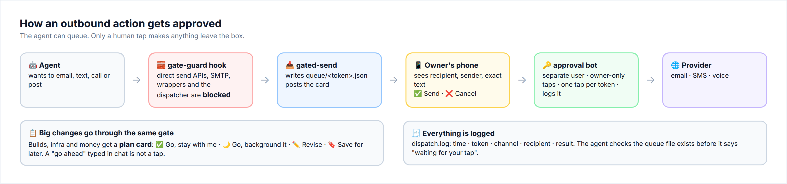
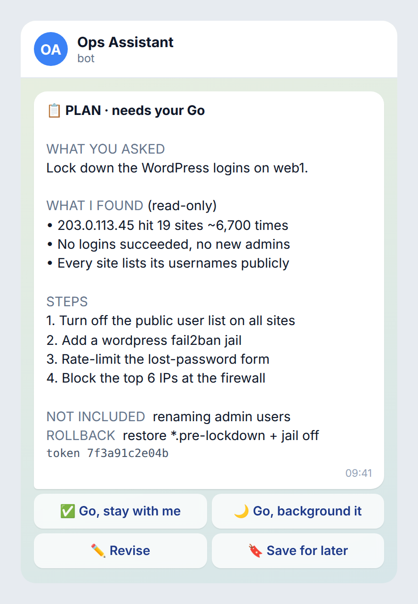
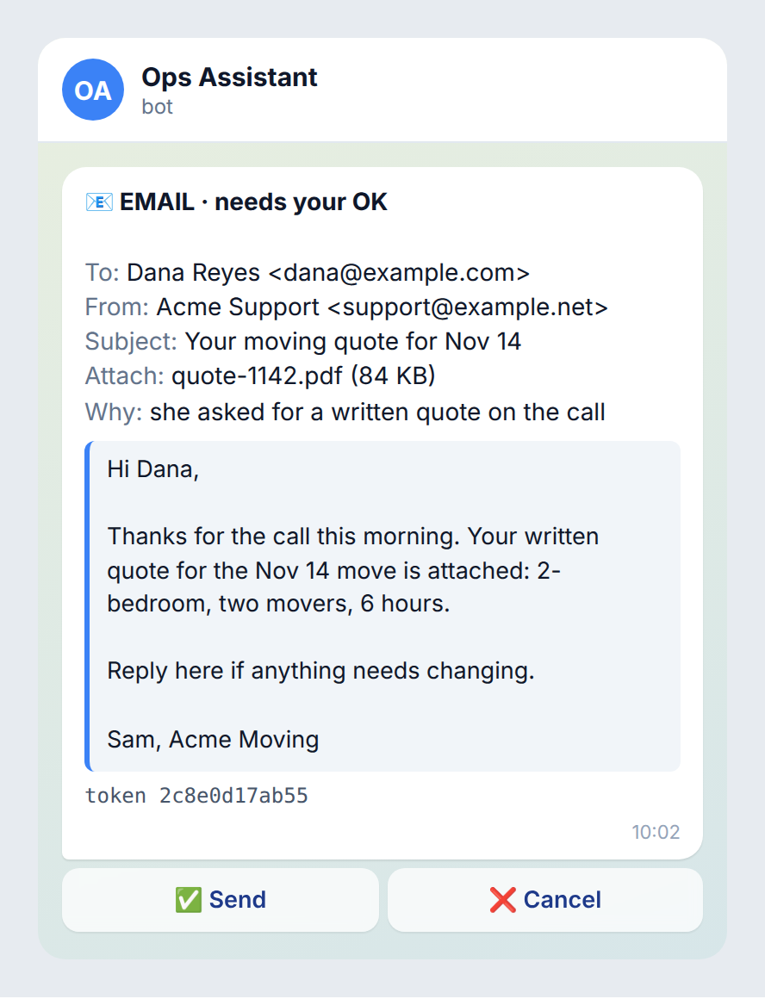

# Secure Agent Ops

**A field manual for running AI agents on your own servers without getting burned.**

AI coding and ops agents are great at doing things. That is the problem. An agent with a shell can open a port, copy a backup into a public folder, paste an API key into a log, or send an email to a customer. It does all of this quickly and confidently, and it is usually right.

This repo is what we wish we had on day one. It comes from running a small fleet of Linux boxes (an "agent brain", a shared web/mail host, and an old cPanel box), with several AI agents doing real work on them every day: building sites, migrating mail, answering leads and making calls. Every practice here exists because something went wrong, or nearly did.

There are two layers:

1. **Box hygiene:** the boring server basics that matter far more once an agent is working at machine speed. These are SSH keys, a firewall, fail2ban, clean web roots, locked secret files and a daily drift check.
2. **Agent guardrails:** the part most guides skip. A human approves anything that leaves the box. A hook physically blocks the agent from going around that approval. Big changes go on a plan card, and only a tap counts as a "go".



---

## Quick start (30 minutes on a fresh Ubuntu 24.04 box)

```bash
git clone https://github.com/<you>/secure-agent-ops.git && cd secure-agent-ops

# 1. SSH: keys only (test a 2nd session BEFORE you log out of the first)
sudo install -m 644 scripts/ssh/99-hardening.conf /etc/ssh/sshd_config.d/
sudo sshd -t && sudo systemctl reload ssh

# 2. Firewall with a 5-minute dead-man auto-undo
sudo cp scripts/firewall/firewall.sh /usr/local/sbin/ && sudo chmod 700 /usr/local/sbin/firewall.sh
sudo $EDITOR /usr/local/sbin/firewall.sh                 # set PUBLIC_TCP / PUBLIC_UDP
sudo scripts/firewall/apply-with-deadman.sh              # then test from OUTSIDE, then confirm

# 3. fail2ban that actually counts (the Ubuntu 24.04 journalmatch gotcha)
sudo apt install -y fail2ban
sudo cp scripts/fail2ban/jail.d/*.local /etc/fail2ban/jail.d/
sudo systemctl restart fail2ban && sudo fail2ban-client status sshd

# 4. Security updates on autopilot (no surprise reboots)
sudo scripts/updates/enable-unattended.sh

# 5. Daily security sweep that only alerts on drift
sudo scripts/sweep/install.sh

# 6. Agent guardrail: block direct sends, force the approval gate
cp scripts/agent/gate-guard.sh ~/.local/bin/ && chmod +x ~/.local/bin/gate-guard.sh
# merge scripts/agent/claude-settings.example.json into your agent's settings
```

Then work through the checklists in [guides/08-checklists.md](guides/08-checklists.md).

---

## The guides

| # | Guide | What you get |
|---|---|---|
| 01 | [SSH & identity](guides/01-ssh-identity.md) | One key per agent/person, one key per box, `~/.ssh/config` aliases, rotation, root key-only, the "second session" rule |
| 02 | [New-box checklist](guides/02-new-box-checklist.md) | Default-drop firewall (v4 + v6) with a dead-man switch, fail2ban on every door, unattended upgrades, admin panels allowlisted + 2FA, kill unused services, bind internals to localhost/VPN |
| 03 | [Web roots](guides/03-web-roots.md) | Why `.bak`, `.sql` and `.env` files keep ending up public, and server rules for Caddy, Apache and nginx that 404 them anyway |
| 04 | [Secrets](guides/04-secrets.md) | One `600` file per key, never inline, never in chat, a transcript scrubber, rotate-if-exposed |
| 05 | [Active defense](guides/05-active-defense.md) | Auto-ban the hammering IPs, a daily sweep timer, alert only on drift |
| 06 | [Audit playbook](guides/06-audit-playbook.md) | A read-only incident walkthrough + two real (sanitized) case studies |
| 07 | [Agent guardrails](guides/07-agent-guardrails.md) | Approval gate, send-blocking hook, tap-only plan cards, non-root team user, attempt caps, sandboxing untrusted repos |
| 08 | [Checklists](guides/08-checklists.md) | One printable page per guide |

## What's in `scripts/`

| Path | What it is |
|---|---|
| `ssh/99-hardening.conf` | sshd drop-in: keys only, no root password |
| `ssh/ssh-config.example` | Per-box aliases with per-box keys |
| `ssh/rotate-key.sh` | Rotate one agent's key on one box without locking yourself out |
| `firewall/firewall.sh` | iptables/ip6tables default-drop in its own chain, with `on` / `off` / `status` |
| `firewall/apply-with-deadman.sh` | Applies the firewall and auto-reverts in 5 minutes unless you confirm |
| `fail2ban/jail.d/*.local` | sshd (24.04-correct), postfix/dovecot, Webmin, WordPress login |
| `fail2ban/filter.d/wordpress-login.conf` | Filter for wp-login / xmlrpc / lost-password floods |
| `updates/enable-unattended.sh` | Security-only unattended upgrades, no auto-reboot |
| `sweep/security-sweep.sh` + `.service` + `.timer` | Daily drift check: ports, baks in web roots, failed logins, new admins, changed PHP, webshells, SUID drift, readable creds in /tmp |
| `webroot/caddy-block-snippet`, `apache-block.conf`, `nginx-block.conf` | Server rules that 404 backup/dump/config files |
| `webroot/move-baks-out.sh` | Moves backup files OUT of web roots (dry-run by default, never deletes) |
| `secrets/new-secret.sh` | Saves a secret into its own `600` file without echoing it |
| `secrets/scrub-transcripts.py` | Replaces known secret values in logs/transcripts with a pointer |
| `agent/gate-guard.sh` | PreToolUse hook that blocks direct send primitives |
| `agent/claude-settings.example.json` | Hook wiring example |
| `agent/approval-bot/` | Minimal Telegram approval-card bot (send cards + plan cards), stdlib Python |

Everything is generic and commented. Read a script before you run it, as you would any script from the internet.

## What the cards look like

<p>


</p>

More in [guides/07-agent-guardrails.md](guides/07-agent-guardrails.md). Every name, number, domain and IP in this repo is made up. Domains use `example.com`, and IPs come from the documentation ranges (`192.0.2.0/24`, `198.51.100.0/24`, `203.0.113.0/24`, `2001:db8::/32`).

## Principles

1. **Assume the agent will do exactly what you allowed.** Give it a narrower permission instead of a stronger prompt.
2. **Anything that leaves the box gets a human tap.** That covers email, SMS, calls, posts and payments. A verbal "go ahead" in chat is not a tap.
3. **Default-deny, then allowlist.** This applies to ports, file types in web roots and commands the agent can run.
4. **Every change gets a rollback, written before the change.**
5. **Alert on drift, not on noise.** A daily report that always says "all good" gets ignored. One that only speaks when something changed gets read.
6. **Read-only first.** Audit before you fix. Prove the problem, then make one change at a time.

## License

Docs: CC BY 4.0. Scripts: MIT. See [LICENSE](LICENSE).
