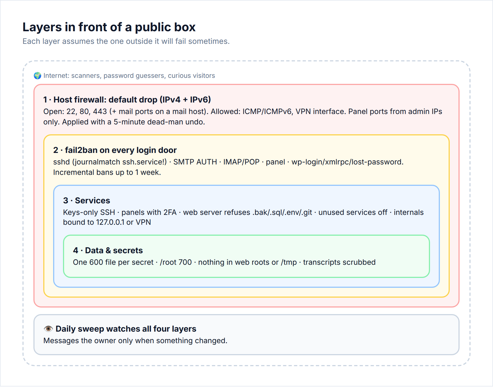

# 02 · New-box checklist

> **Goal:** every box you provision or take over reaches the same baseline before an agent does any real work on it.

We learned this the expensive way. We audited a busy shared web/mail host and found no firewall at all. The firewall package had been uninstalled at some point, and every port was open on IPv4 and IPv6. On our agent box, a set of transparent proxy ports was reachable from the whole internet. Scanners found them, the proxy started looping traffic back into itself, and one of our VPN tunnels was dead for almost a day before anyone noticed.

Neither box had been "hacked". Both had been left with the door open.



## 1. Firewall: default-drop, IPv4 *and* IPv6, with a dead-man switch

The rules:

- **Allow:** loopback, established/related, ICMP (many hosts ping your box for monitoring, and some will open a ticket or intervene if ping stops answering), **ICMPv6** (IPv6 does neighbour discovery over ICMPv6, so if you drop it, v6 dies), DHCP if you use it, and the service ports that *must* be public.
- **Trust:** your VPN interface (`wg+`) if you have one.
- **Drop:** everything else.
- **Do it for v6 too.** A v4-only firewall on a dual-stack box is a firewall with a side door. Check with `ip -6 addr`.

[`scripts/firewall/firewall.sh`](../scripts/firewall/firewall.sh) keeps the rules in their own chains (`AGENTOPS-IN`, `AGENTOPS-IN6`) hooked from the *end* of `INPUT`. Other tools that insert at the top (wg-quick, Docker, fail2ban) keep working, and `firewall.sh off` removes only what it added.

### The dead-man switch

Firewall mistakes lock you out. The fix is to schedule the rollback *before* you apply:

```bash
# schedule "firewall off" in 5 minutes, as a transient systemd timer
systemd-run --unit=fw-deadman --on-active=300 /usr/local/sbin/firewall.sh off
/usr/local/sbin/firewall.sh on

# now, from ANOTHER machine: ssh in, curl your sites, check mail ports, ping
# all good? cancel the rollback:
systemctl stop fw-deadman.timer
```

If you lock yourself out, wait five minutes and you're back in.

[`scripts/firewall/apply-with-deadman.sh`](../scripts/firewall/apply-with-deadman.sh) wraps this with a prompt. **Always test from outside.** Testing from the box itself goes over loopback and proves nothing.

## 2. fail2ban on every door

SSH is not your only login. List every port that asks for a password: SSH, SMTP AUTH, IMAP/POP3, FTP, the hosting panel (Webmin/cPanel/Plesk) and every WordPress `wp-login.php`.

### ⚠️ The Ubuntu 24.04 gotcha

On 24.04 the SSH daemon runs as `ssh.service`, not `sshd.service`. The stock `sshd` jail with the systemd backend matches on `_SYSTEMD_UNIT=sshd.service`. It **silently counts nothing**. `fail2ban-client status sshd` says "Currently failed: 0" forever while bots hammer you.

Fix ([`scripts/fail2ban/jail.d/sshd.local`](../scripts/fail2ban/jail.d/sshd.local)):

```ini
[sshd]
enabled      = true
backend      = systemd
journalmatch = _SYSTEMD_UNIT=ssh.service + _COMM=sshd
maxretry     = 5
findtime     = 10m
bantime      = 1h
bantime.increment = true
bantime.maxtime   = 1w
ignoreip     = 127.0.0.1/8 ::1 10.0.0.0/8 192.0.2.10
```

**Verify that it counts:** from another machine, fail a login on purpose, then check that `Total failed` went up. If it didn't, the jail isn't working.

Put **your own boxes and your VPN subnet in `ignoreip`**. Otherwise an agent that offers the wrong key five times will ban your control box from your own server.

## 3. Unattended security updates

Use security-only updates with no automatic reboot, so you choose when a kernel update takes effect. Track the "reboot required" flag in your daily sweep instead. See [`scripts/updates/enable-unattended.sh`](../scripts/updates/enable-unattended.sh).

## 4. Admin panels: allowlisted + 2FA

Hosting panels (Webmin, cPanel, Plesk, phpMyAdmin) should never be open to the internet with only a password in front of them. Do both of these:

- **IP allowlist:** only your office/VPN/control-box IPs can reach the panel port. Do it in the firewall, or in the panel's own allow setting.
- **2FA** for every panel user, root included.

> **Seen in the wild:** a Webmin panel open to the internet with no 2FA on any user, and bots steadily trying `root` and `admin`.

## 5. Turn off what nobody uses

> **Seen in the wild:** FTP was running with **~33,000 failed logins** in its logs and **zero** successful ones in the last 14 days.

Check, then disable:

```bash
ss -tulpn                                   # what is listening, on which address
last -n 50; journalctl -u <service> --since -14d | grep -i 'login ok\|authenticated'
systemctl disable --now proftpd             # or vsftpd/pure-ftpd
```

## 6. Bind internals to localhost or the VPN

Databases, Redis, admin APIs, metrics, local LLM servers and **anything an agent spins up "just to test"** should listen on `127.0.0.1` or your VPN IP. They should never listen on `0.0.0.0`.

**Transparent proxies are the worst case.** If one is reachable from outside, you are running an open relay. In our case, scanners caused a routing loop through it.

```bash
ss -tlnp | awk '$4 !~ /^(127\.|\[::1\]|10\.)/'      # public TCP listeners
```

Every line in that output should be something you meant to make public.

## 7. Monitoring that pings a human

Add at least one timer that checks "is the main thing up?" and messages you when it isn't. Combine it with the daily sweep in [05](05-active-defense.md).

## 8. Write it down

For every box, keep a short note of what's public and why, where the firewall script lives, and how to roll it back, including the **out-of-band console** route (your provider's KVM/IPMI/rescue mode) for when SSH is gone.

## Checklist → [08-checklists.md#02](08-checklists.md#02--new-box)
