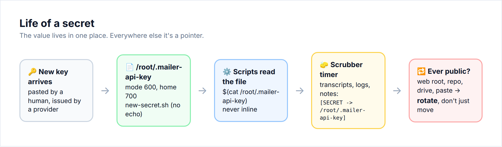

# 04 · Secrets

> **Goal:** every secret lives in exactly one locked file. Everywhere else, it appears only as a pointer to that file.

## The problem with agents and secrets

An agent that reads a key will happily:

- print it in tool output ("Here's the config: `API_KEY=sk_live_…`"),
- inline it in a script it writes for you,
- quote it back in its summary,
- store it in its long-term memory notes "for next time".

All of that lands in transcripts, logs and memory files that are kept forever, searched by other agents, and backed up off-box.

When we first counted, our agent box had **about 5,000 plain-text copies** of roughly 340 distinct secrets spread across ~800 transcripts and notes. We also had a cloud-provider API secret written inline in a world-readable (`644`) script.

## The rules

1. **One secret, one file, mode `600`.** Name it after the service and the key's purpose:
   ```bash
   scripts/secrets/new-secret.sh /root/.mailer-api-key     # prompts, no echo, writes 600
   ```
   Or, by hand:
   ```bash
   install -m 600 /dev/null /root/.mailer-api-key
   read -rs KEY && printf '%s' "$KEY" > /root/.mailer-api-key && unset KEY
   ```
2. **Scripts read the file. Never inline the key.**
   ```bash
   curl -H "Authorization: Bearer $(cat /root/.mailer-api-key)" https://api.example.com/...
   ```
   ```python
   KEY = open("/root/.mailer-api-key").read().strip()
   ```
3. **The secret never goes into chat.** Agents should use `$(cat file)`, not `cat file`. If you need to *see* it, read the file yourself in your own terminal.
4. **Memory notes store pointers, not values.** Write "mailer key → `/root/.mailer-api-key`", never the key.
5. **The home directory protects the files.** `/root` (or the agent user's home) must be `700`. A `600` file inside a `755` home is still safer than a `644` one, but check both.
6. **Never in a web root, shared drive, git repo or `/tmp`.**
7. **Exposed means rotate.** If a key was ever in a public web root, a public repo, a shared drive or a paste, **rotate it**. Moving it does not undo a download that already happened.



## The transcript scrubber

Even with good rules, secrets get into transcripts: a user pastes one, or a tool's error message echoes it. So we scrub, on a timer.

[`scripts/secrets/scrub-transcripts.py`](../scripts/secrets/scrub-transcripts.py):

1. builds an **inventory** of secret values by reading your locked files (`/root/.*` with mode `600`, plus any extra files you list),
2. walks your transcript/log/memory directories,
3. replaces every exact occurrence of a known secret with `[SECRET -> /root/.mailer-api-key]`.

The agent can still *use* the secret because it knows where it lives, but the value is gone from history.

```bash
python3 scrub-transcripts.py --dry-run ~/.agent/transcripts     # show counts, change nothing
python3 scrub-transcripts.py ~/.agent/transcripts ~/.agent/memory
```

Run it every 10–15 minutes over recent files, plus a full pass nightly. **Back up the transcripts first** (encrypted, `600`) the first time you run it, in case the inventory picks up something that isn't really a secret.

It also has a `--find-unknown` mode that flags key-*shaped* strings (`sk_live_…`, `AKIA…`, `ghp_…`, `xox…-`) that **aren't** in any locked file. Those are secrets someone pasted that never got a home. Save them to a file first, then scrub.

## Agent instructions (paste into your system prompt)

> When you receive or create any secret (API key, password, token, private key, webhook secret):
> 1. Save it immediately to its own file with mode 600 (`install -m 600 /dev/null /root/.<service>-<what>`).
> 2. Never print it, echo it, or include it in a script, a reply, a memory note, a commit, or a URL.
> 3. Use it only via `$(cat /root/.<file>)` or by reading the file in code.
> 4. In notes, write `<name> → /root/.<file>`.
> 5. If it was ever exposed publicly, say so and propose rotation.

## Checklist → [08-checklists.md#04](08-checklists.md#04--secrets)
