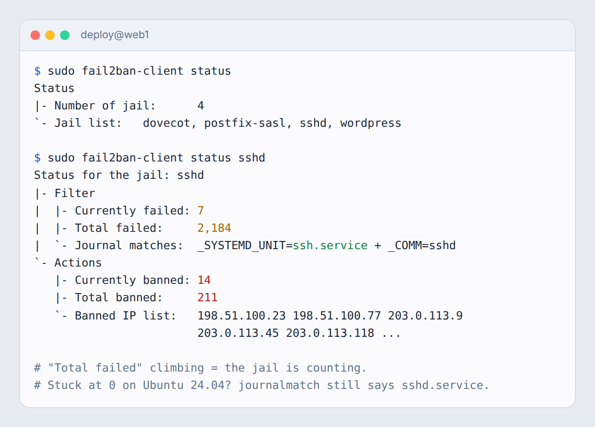
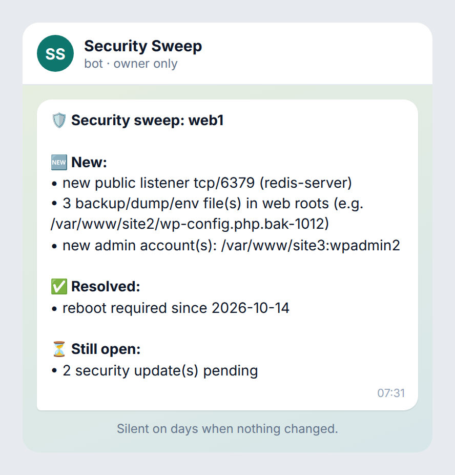

# 05 · Active defense

> **Goal:** the box pushes back on attackers by itself, and tells you, briefly, only when something *changed*.

## Background noise is real

On any public box with SSH on port 22, expect **thousands of failed logins a day**. Ours took ~2,200/day before fail2ban was counting properly. A WordPress host sees the same on `wp-login.php`. In one 24-hour window, five different IPs each hit wp-login more than 2,000 times on our old hosting box.

You can't read all of that, and you shouldn't try. Ban automatically, and alert only on what's *new*.

## 1. Auto-ban the hammering IPs

fail2ban jails for every login door ([02](02-new-box-checklist.md#2-fail2ban-on-every-door)), plus **incremental bans** so repeat offenders stay out longer:

```ini
[DEFAULT]
bantime.increment = true
bantime.factor    = 2
bantime.maxtime   = 1w
```

For WordPress, use [`scripts/fail2ban/filter.d/wordpress-login.conf`](../scripts/fail2ban/filter.d/wordpress-login.conf) + the `wordpress` jail. It catches `POST /wp-login.php`, `POST /xmlrpc.php`, `?action=lostpassword` floods and `/wp-json/wp/v2/users` enumeration.

Check what fail2ban is doing:

```bash
fail2ban-client status
fail2ban-client status sshd
```



## 2. The daily security sweep

[`scripts/sweep/security-sweep.sh`](../scripts/sweep/security-sweep.sh) runs once a day from a systemd timer. Each check produces "OK" or a line of drift:

| Check | Drift looks like |
|---|---|
| Public listeners vs allowlist | `new public listener tcp/6379 (redis-server)` |
| Firewall + fail2ban actually on | `firewall chain missing`, `fail2ban sshd jail not loaded`, `jail counting 0 failures in 24h` |
| SSH config | `PasswordAuthentication not 'no'` |
| Backup/dump/env files in web roots | `3 backup file(s) in web roots (e.g. /var/www/site/wp-config.php.bak)` |
| Block rule answering | `probe https://example.com/x.bak-probe returned 200` |
| Failed logins | `ssh failed logins 24h: 18,420 (baseline 2,100)`, alerting on a jump, not on the noise |
| New admin users | `new sudo/wheel member: bob`, `new WordPress administrator on site3: wpadmin2` |
| Changed PHP | `14 .php files changed in 24h under /var/www (outside known deploys)` |
| Webshell signatures | `possible webshell: /var/www/site/wp-content/uploads/x.php (eval(base64_decode)` |
| PHP in uploads | `PHP file in an uploads dir: …/uploads/2026/10/cache.php` |
| SUID drift | `new SUID binary: /usr/local/bin/helper` |
| Readable creds in /tmp | `world-readable file in /tmp containing 'password=': /tmp/fix.sh` |
| Pending reboot / security updates | `reboot required since 2026-10-14` |

### Alert only on drift

The sweep keeps the last result in `/var/lib/security-sweep/last.txt` and only messages you when the set of drift lines **changes**:

- New problem → alert.
- Same problem as yesterday → stay quiet. Optionally, send a weekly "still open" reminder.
- Problem gone → one "resolved" line.



A report that says "all good" every day trains you to ignore it. Silence should mean "all good".

### Install

```bash
sudo scripts/sweep/install.sh           # copies script + service + timer, enables the timer
sudo $EDITOR /etc/security-sweep.conf   # allowlists, web roots, alert command
sudo /usr/local/sbin/security-sweep.sh --print   # run now, print, don't alert
```

The alert command is pluggable (`ALERT_CMD` in the conf): a Telegram bot, email, ntfy or a webhook. Keep the alert channel **owner-only**. A security alert is not something your agent forwards to customers.

### Baselines

The SUID check and the "new admin" check need a baseline. The first run writes `/var/lib/security-sweep/*.baseline` and reports nothing. After a change you made on purpose, re-baseline:

```bash
sudo security-sweep.sh --rebaseline suid
```

## 3. Weekly deeper audit

Once a week, run the slower checks:

- Check package integrity (`debsums -c` / `rpm -Va`).
- Diff the full list of cron jobs and systemd units.
- Look for secrets readable by other users.
- Search the last week of agent transcripts for key-shaped strings ([04](04-secrets.md)).

## Checklist → [08-checklists.md#05](08-checklists.md#05--active-defense)
