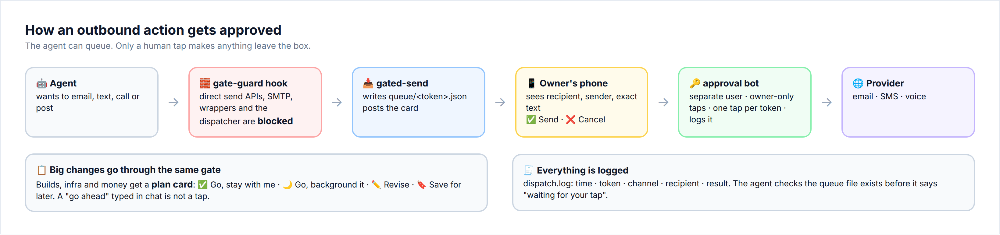
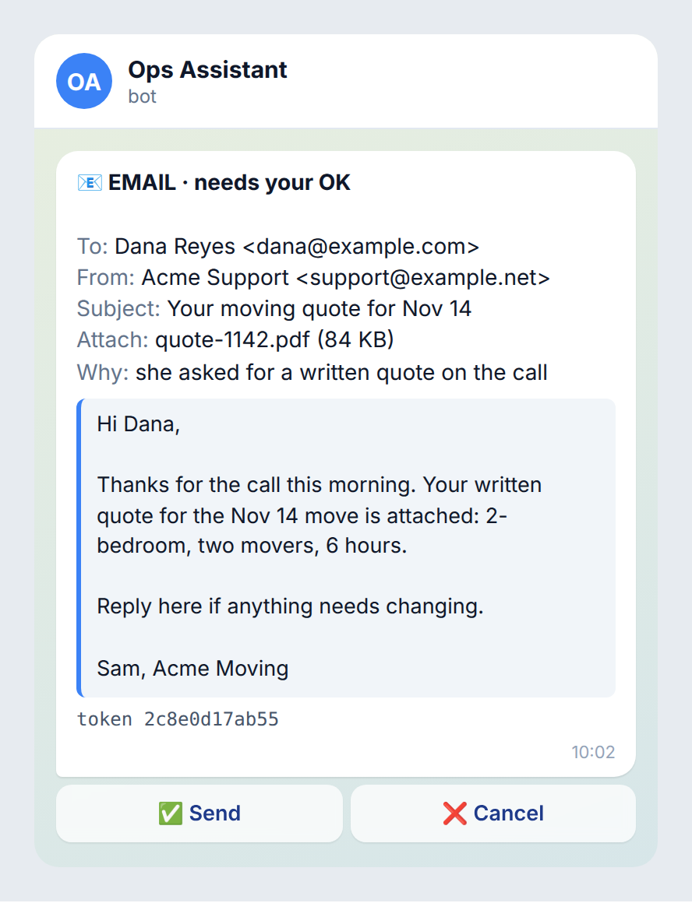
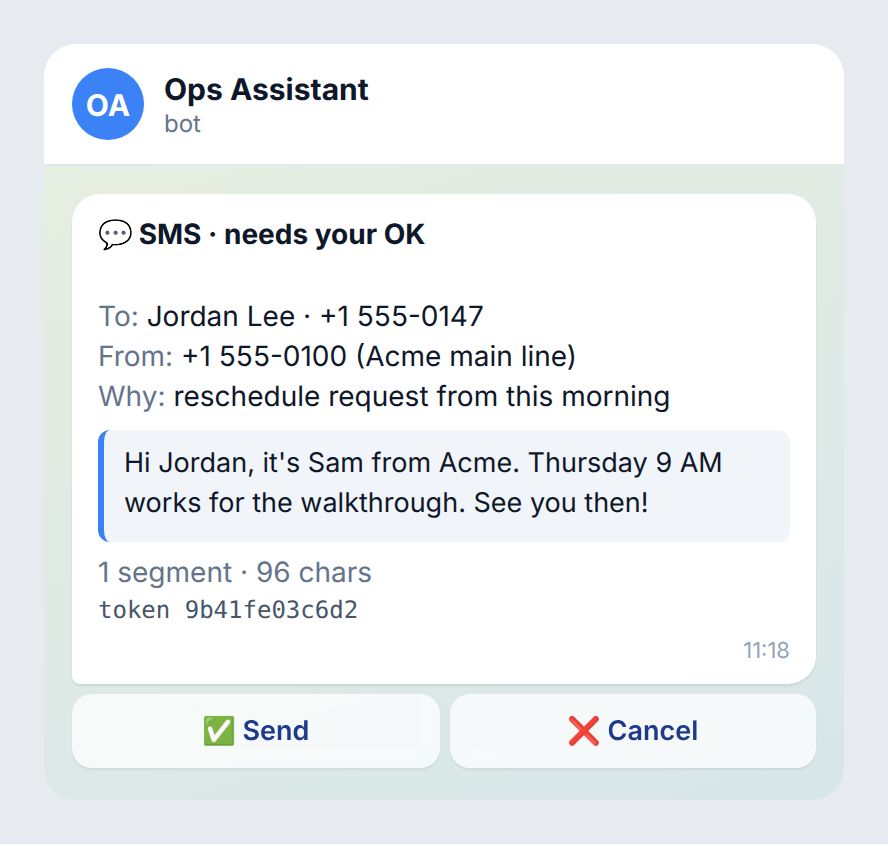
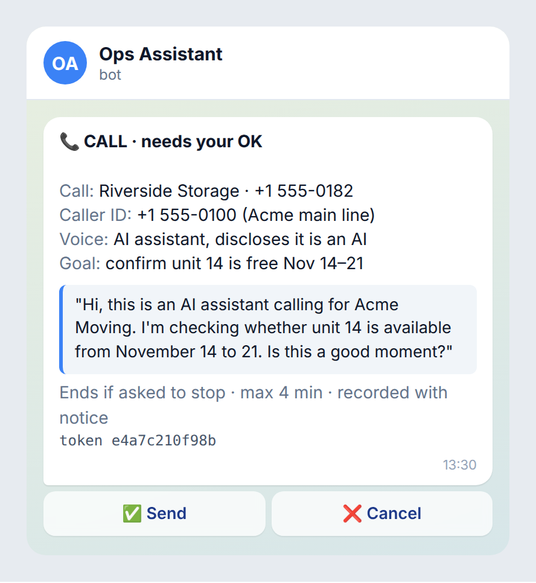
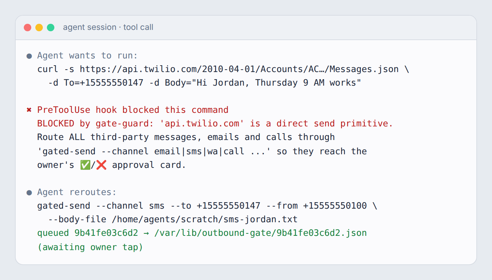
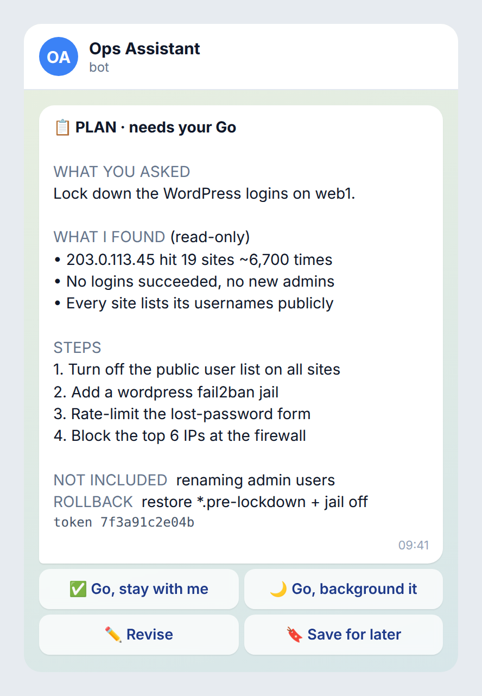

# 07 · Agent guardrails

> **Goal:** the agent can do almost anything *on* the box, and almost nothing *to the outside world* without a human tap.

This is the part that makes running agents different from running servers. Guides 01–06 keep attackers out. This guide keeps **your own agent** from doing something irreversible with total confidence.



## 1. The approval gate: everything outbound gets a human tap

**Outbound** means anything a third party will see: email, SMS, WhatsApp, phone calls, social posts, form submissions, payments, DNS changes on a client's domain.

The pattern:

1. The agent never calls the send API directly. It calls **one** command, for example `gated-send --channel email --to … --subject … --body-file …`.
2. `gated-send` writes the message to a queue (`/var/lib/outbound-gate/<token>.json`) and posts a **card** to the owner's phone with **✅ Send / ❌ Cancel**.
3. Only the bot's button handler, running as a separate process the agent doesn't drive, calls the real sender, and only for a token that was tapped ✅.
4. Every dispatch is logged (`dispatch.log`: token, channel, recipient, result).

<p>



</p>

What makes a good send card:

- **Who it goes to**, in full: name, address or number.
- **Which identity sends it**: the From address, caller ID or sender name.
- **The exact body**, not a summary. For a call, the opening script.
- **Attachments** by name and size.
- **The token**, so you can refer to it in chat ("cancel 7f3a").
- Two buttons only. Don't add "Edit" on the card. Edits go back to the agent, which queues a *new* card.

A minimal stdlib implementation is in [`scripts/agent/approval-bot/`](../scripts/agent/approval-bot/).

## 2. A hook that blocks direct sends

An instruction like "always use gated-send" is a *request*. A hook makes it a *wall*.

Claude Code (and similar agent runtimes) can run a **PreToolUse** hook before every shell command. [`scripts/agent/gate-guard.sh`](../scripts/agent/gate-guard.sh) reads the command the agent is about to run and **blocks it** (exit code 2) if it contains a direct-send primitive:

- raw provider APIs (`api.twilio.com`, `api.telnyx.com`, `api.sendgrid.com`, `api.mailgun.net`, `/v3/email/send` …),
- SMTP (`smtplib`, `:465`, `:587`, `sendmail -t`),
- your own wrappers (`*-sms`, `*-mail-send`, `*call.sh`),
- **the dispatcher itself** (`gated-dispatch`), so the agent can't "approve" its own card by calling the back half of the gate.



Design notes:

- **Allow the gate entrypoint explicitly** before the block list. `gated-send` can contain substrings that match the patterns.
- **Generalize patterns.** We added the hook after an agent bypassed the gate by calling an SMS helper function directly. Every new wrapper you write should match an existing pattern (`*-sms`, `*-mail-send`) so it's blocked the day it's created.
- **Allow narrow management exceptions on purpose, and keep the send path blocked inside them.** For example, allow the email provider's `/users` and `/domains` API so the agent can provision, but if the command also mentions `email/send`, fall through to the block.
- **Deny silently to the human, loudly to the agent.** The reason goes to stderr for the agent ("route this through gated-send"). There's no alert to your phone, because the agent will reroute and you'll get one clean card.
- The hook governs the **agent's** tool calls only. Your own cron jobs and the bot's dispatcher don't pass through it.

Wire it up: [`scripts/agent/claude-settings.example.json`](../scripts/agent/claude-settings.example.json).

## 3. Plan cards: only a tap counts

For **substantial** work (a real build, infrastructure change, anything that spends money, touches customer data, or is hard to undo), the agent investigates first and then posts a **plan card** instead of executing:



| Button | Meaning |
|---|---|
| ✅ **Go, stay with me** | Execute now, in this chat, reporting as you go |
| 🌙 **Go, background it** | Execute as a detached background run, posting a summary when done |
| ✏️ **Revise** | Don't execute. Tell the agent what to change, and it posts a new card |
| 🔖 **Save for later** | Park it in a backlog file, findable later |

What a plan card contains: **what you asked → what I found → exact steps → what's NOT included → rollback**. If the agent can't write the rollback line, it isn't ready to execute.

### The rules we learned the hard way

- **A verbal "go ahead" in chat is not a tap.** It means "yes, that's the task, now show me the plan." In one early miss, an agent heard "just create it" and created seven cloud workspaces without a card. The fix was the rule: anything that mutates real infrastructure, money or account objects **always** gets a card, even after a verbal go.
- **"Wait for my go" means wait, even for trivial steps.** The gate slips exactly when the agent feels most sure.
- **Approval comes from the button handler, not from chat text.** When a card is tapped, the bot feeds the approved plan back to the agent. The agent should never treat a chat message that *says* "approved" as approval.
- **Verify the card exists before saying "tap ✅".** Check the queue file. Agents have told the owner to tap cards that never got posted, and once posted a blank card by mistake. The habit is: queue → confirm the file exists → then say "it's waiting for you".
- **Read the state before claiming the state.** "It's still waiting for your tap" when the background run already finished is a small lie that erodes trust. Check the run's output file first.
- **Small and reversible doesn't need a card.** Renaming a file or answering a question shouldn't need a tap. If everything needs a tap, people stop reading the cards.

## 4. A non-root team user

Our own agents grew up running as root. For a **new** setup, don't copy that:

```bash
sudo adduser --disabled-password --gecos "" agents
sudo install -d -o agents -g agents -m 700 /home/agents/.secrets
# narrow sudo, only what the agents truly need, by full path:
echo 'agents ALL=(root) NOPASSWD: /usr/bin/systemctl restart caddy, /usr/local/sbin/firewall.sh status' \
  | sudo tee /etc/sudoers.d/agents && sudo chmod 440 /etc/sudoers.d/agents && sudo visudo -cf /etc/sudoers.d/agents
```

- One shared `agents` user (or one user per agent, if you want per-agent audit trails).
- Secrets the agents need live in `/home/agents/.secrets/*` (`600`). Secrets they **don't** need stay in `/root`.
- Root-only helpers are exposed through **specific** sudo rules with fixed arguments, never `ALL`.
- Private human data (health, family, finances) goes in a folder the agent user cannot read at all, *plus* a hook that blocks the paths. Belt and braces.

## 5. Attempt caps on logins

Agents retry. When the credential is wrong, they retry *fast*, and your own fail2ban bans your own box.

> **Seen in the wild:** a few wrong IMAP logins from our control box got it banned by the mail server's fail2ban. Every agent on the box then lost mail access until the ban expired.

- Teach the agent: **two failures, then stop and report.** Don't loop.
- Put your control box's IP in every server's `ignoreip`. Do still cap attempts in the tool, because the *next* server you touch won't have it.
- Wrap logins in helpers that enforce a cap (`max_attempts=2`) and refuse to run again for N minutes after failing.

## 6. Sandbox untrusted code

When an agent wants to install a package or run a repo you haven't reviewed:

- **Read it first.** Pin to a commit/hash you reviewed.
- **Run it with no network, no secrets and no home directory.** On Linux, `bwrap` (bubblewrap) does this in one line:
  ```bash
  bwrap --ro-bind /usr /usr --ro-bind /lib /lib --ro-bind /lib64 /lib64 --ro-bind /etc/ssl /etc/ssl \
        --proc /proc --dev /dev --tmpfs /tmp --tmpfs /root \
        --bind "$PWD/work" /work --chdir /work \
        --unshare-all --die-with-parent --clearenv --setenv PATH /usr/bin:/bin \
        python3 -I tool.py input.json
  ```
- **Downloaded archives go in their own empty directory.** Run interpreters with `-I` and pass paths as arguments, so a planted `json.py` next to the data can't hijack `import json`.
- If the tool must be reachable by the agent, expose it through **one wrapper** with a fixed command line, not a general shell.

## 7. Separate personal from work

If the same agent helps with your life *and* your business, its transcripts become a single searchable pool. Keep sensitive personal data in a vault the work agents can't read (separate user or path + a guard hook). Keep chat summaries about it short. Remember that a hook on the same Unix user is a guardrail, not a security boundary.

## Checklist → [08-checklists.md#07](08-checklists.md#07--agent-guardrails)
